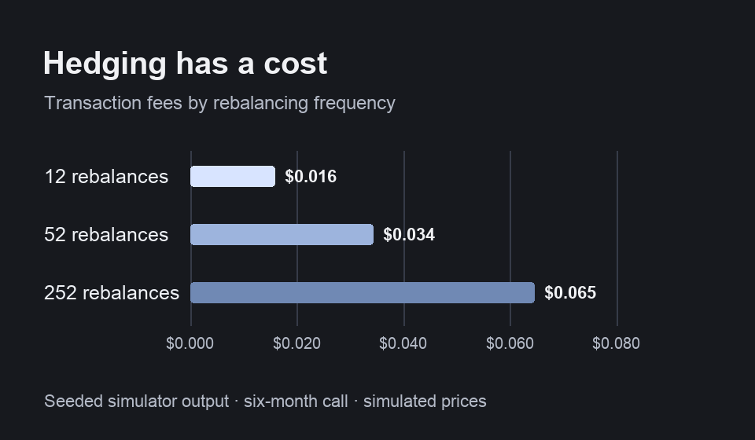

# Options Market-Making Laboratory

This project studies one question:

> How do pricing assumptions, discrete hedging, transaction costs, spreads, and inventory limits affect an options market maker's simulated P&L?

It is an educational simulator—not investment advice, a trading system, or evidence of profitability.

## What is implemented

- European call and put payoffs
- Black–Scholes prices and Greeks
- Cox–Ross–Rubinstein binomial pricing
- Seeded Monte Carlo pricing with confidence intervals
- Discrete delta-hedging simulations with costs and volatility mismatch
- Inventory-aware quotes and simple simulated customer order flow
- Reconciled P&L attribution
- Reproducible demonstration experiments

## Run

```bash
python3 -m unittest discover -s tests -v
python3 -m options_lab.experiments --out reports/demo_results.json
```

No third-party packages are required.

## Study order

Work through [`LEARNING_GUIDE.md`](LEARNING_GUIDE.md) before treating the simulator as portfolio evidence. The goal is to explain each model, predict how a parameter change should behave, and then use the code to test that prediction.

## Repository map

- `options_lab/models.py`: typed domain objects and policies
- `options_lab/pricing.py`: analytical and binomial pricing
- `options_lab/monte_carlo.py`: simulation price estimates
- `options_lab/hedging.py`: GBM paths and discrete delta hedging
- `options_lab/market_maker.py`: quote, order-flow, inventory, and hedge simulation
- `options_lab/experiments.py`: reproducible comparison runner
- `tests/`: mathematical invariants and accounting checks


## Example output

Transaction fees from the seeded six-month European call experiment across three hedge frequencies.


